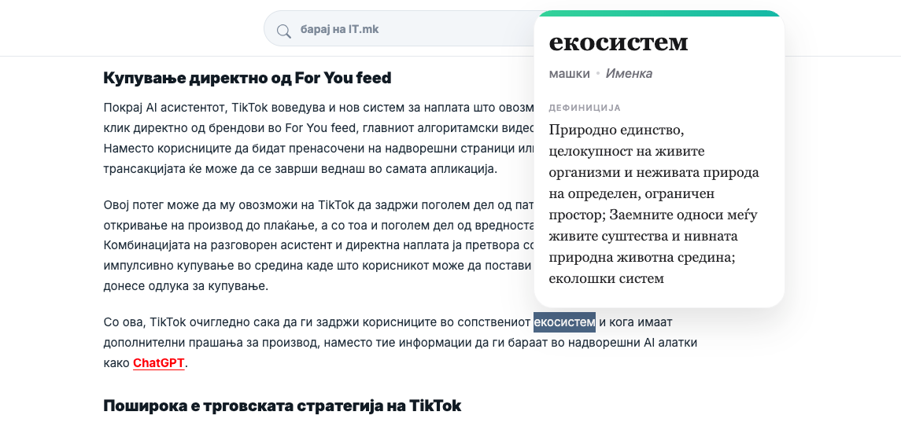

# ЗБОРко (Zborko)

A Chrome extension (Manifest V3) that explains the meaning of Macedonian words.
Select a single Macedonian word on any web page and a tooltip appears with its
definition, part of speech, gender, and usage examples.

## Features

- **Select-to-explain** — highlight one Macedonian word to fetch its definition.
- **Rich tooltip** — shows the word, gender, part of speech, a definition, and up
  to three usage examples.
- **Per-site and global toggle** — turn explanations off everywhere, or only on
  specific sites, from the extension popup.
- **In-memory cache** — repeated lookups on a page are instant.
- **Macedonian-aware** — only triggers for words written in the Macedonian
  Cyrillic alphabet.

## Demo



## Installation (development)

1. Clone the repository:
   ```bash
   git clone https://github.com/mitevskasara/zborko-web-extension.git
   ```
2. Open Chrome and go to `chrome://extensions`.
3. Enable **Developer mode** (top-right).
4. Click **Load unpacked** and select the `src/` directory.

The extension is now active. Reload the extension from `chrome://extensions`
after making code changes.

## Usage

1. Open any web page.
2. Select a single Macedonian word with your mouse.
3. A tooltip appears with the definition.
4. Click the extension icon to:
   - turn explanations on/off for the current site,
   - turn them on/off globally,
   - remove sites from the disabled list.

## Configuration

Settings are stored with `chrome.storage.sync` under these keys:

| Key                | Type       | Default | Description                                |
| ------------------ | ---------- | ------- | ------------------------------------------ |
| `disabledGlobally` | `boolean`  | `false` | Disables the extension on all sites.       |
| `disabledSites`    | `string[]` | `[]`    | Hostnames where explanations are disabled. |

## API

The extension sends a `GET` request to
`https://zborko.vercel.app/api/words?zbor=<word>` and expects a JSON response like:

```json
{
  "zbor": "куќа",
  "vid": "именка",
  "rod": "женски",
  "znacenje": "Градба во која живеат луѓе. Куќата е голема."
}
```

| Field      | Meaning                               |
| ---------- | ------------------------------------- |
| `zbor`     | The word (Macedonian).                |
| `vid`      | Part of speech.                       |
| `rod`      | Grammatical gender.                   |
| `znacenje` | Definition, optionally with examples. |

## Project structure

```
.
├── src/
│   ├── manifest.json     # Extension manifest (MV3)
│   ├── background.js     # Service worker; performs API requests
│   ├── index.js          # Content script; selection handling + tooltip UI
│   ├── index.css         # Tooltip styles (injected into pages)
│   ├── popup.html        # Popup markup and styles
│   ├── popup.js          # Popup logic (settings)
│   └── icons/            # Extension icons (16/32/48/128 px)
└── logo.svg              # Source logo
```

## Development

Formatting is handled by [Prettier](https://prettier.io/):

```bash
npm install
npm run format        # format all files
npm run format:check  # verify formatting (used in CI)
```

If you add automated tests, document the command here and in `package.json`.

## Contributing

Contributions are welcome! Please read [CONTRIBUTING.md](CONTRIBUTING.md) and the
[Code of Conduct](CODE_OF_CONDUCT.md) before opening an issue or pull request.

## License

Released under the [ISC License](LICENSE).
